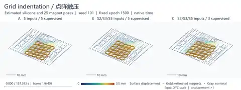
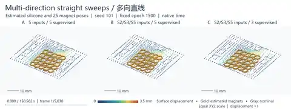
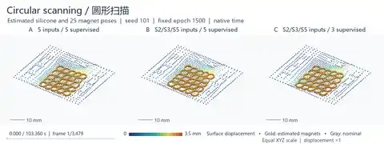
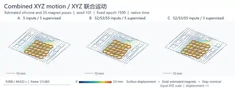
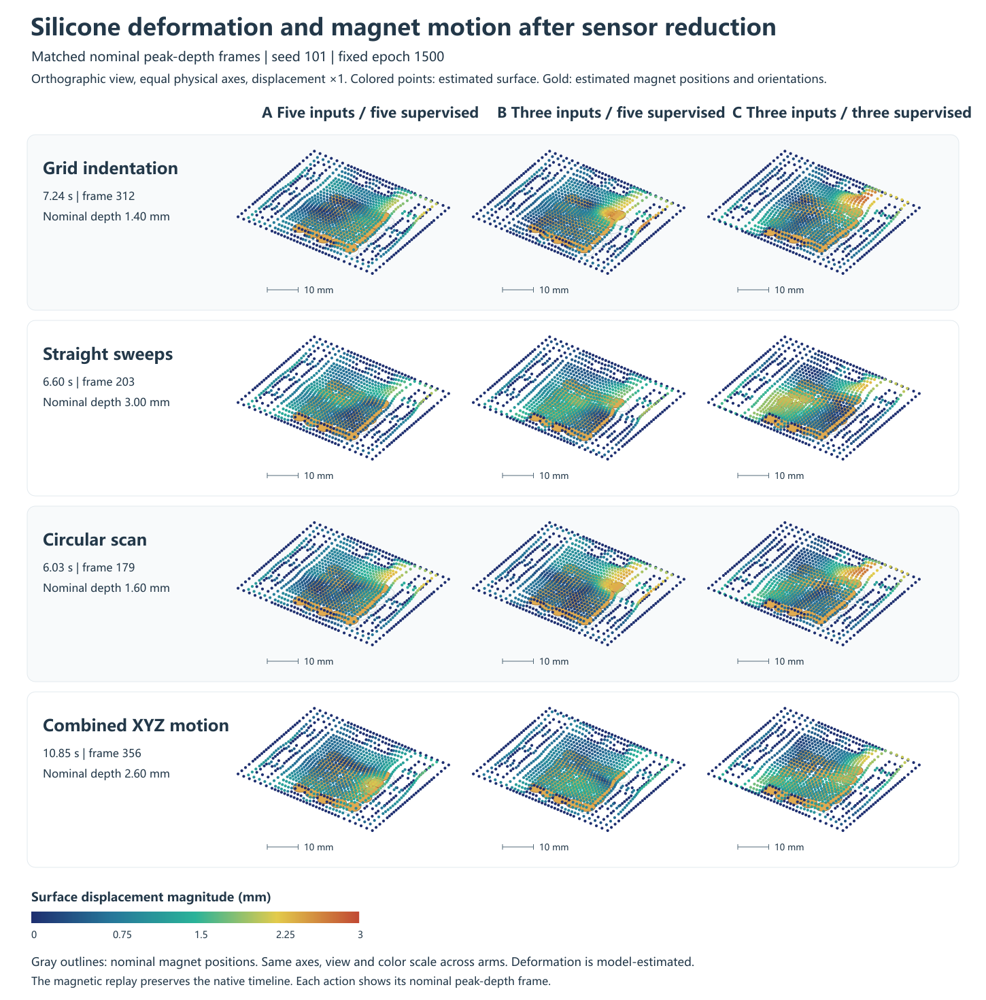

# MagTouch Sparse Localization

Research companion for **From Five to Three: Spatial Sampling and Training Supervision for Magnetic Tactile Localization**.

- English manuscript: [PDF](paper/Sparse_Magnetic_Sensors_EN.pdf) · [Word](paper/Sparse_Magnetic_Sensors_EN.docx) · [source](paper/Sparse_Magnetic_Sensors_EN.md)
- 中文稿：[PDF](paper/Sparse_Magnetic_Sensors_ZH.pdf) · [Word](paper/Sparse_Magnetic_Sensors_ZH.docx) · [源稿](paper/Sparse_Magnetic_Sensors_ZH.md)
- [中文说明](README.zh.md) · [Protocol and data dictionary](docs/protocol.md)

## What the comparison measures

The original five-node CSML localizer remains frozen. The fixed 1500-epoch comparison separates reducing online input from removing supervision at omitted nodes. At common five-node supervision, reducing the input to S2/S3/S5 increased domain-balanced raw mean error by 0.060 mm and sequence P95 by 0.236 mm. Three-node-only supervision instead yielded false-contact declarations on all nominal lifts across the three trained seeds. Layout screening with measured retained nodes and reconstructed omitted nodes is reported separately from fully reconstructed replay.

## 3D silicone deformation and magnet motion

The paired shared-field diagnostic follows the four motion sequences in §3.5. With S2/S3/S5 input, retaining five-node supervision yielded estimates closer to the five-input model across all four sequences. The comparison uses seed 101 at epoch 1500 and evaluates model-to-model agreement. The records do not contain independent measurements of the displacement field or magnet poses.

### Full sequences at their original speed

The full MP4s preserve all **16,577 native frames** and the original frame intervals. In each frame, A, B and C share one timestamp, camera, physical scale and displacement color range. The inline previews play at the same speed with fewer frames for browser display. Select a preview to open its complete video.

| Grid indentation · 6,403 frames · 2:37 | Multi-direction straight sweeps · 5,030 frames · 2:31 |
| --- | --- |
| [](paper/native-shape/grid_native.mp4) | [](paper/native-shape/lines_native.mp4) |
| **Circular scanning · 3,479 frames · 1:43** | **Combined XYZ motion · 1,665 frames · 0:45** |
| [](paper/native-shape/circle_native.mp4) | [](paper/native-shape/xyz_native.mp4) |

[Native-frame timing verification](data/native_shape_video_receipt.json) · [Earlier nine-state overview](paper/XYZ_deformation_demo.gif)



[Shape diagnostic and animation timing](data/shape_state_diagnostic.json) · [中文形变图](paper/Shape_comparison_ZH.png)

## Five-node reference repositories

| Source | Role here |
| --- | --- |
| [MagTouch-CSML, frozen snapshot](https://github.com/googo2025/MagTouch-CSML/tree/02cd40217672b43e0860c9a902ea8b4f77f922ca) | Five-node localization, shared inference weights, normalization and scoring protocol. The [published shared weights](https://github.com/googo2025/MagTouch-CSML/blob/02cd40217672b43e0860c9a902ea8b4f77f922ca/models/shared_provenance.json) match the SHA-256 recorded in this replay. |
| [Five-node shared field](https://github.com/googo2025/magtouch-temporal-state-reconstruction/tree/ca291d4d5324ca4b0fd42658022761cd6cfb9602/methods/shared_field) | Five-node magnetic field reconstruction and the epoch-529 engineering reference. |
| [Original apparatus](https://github.com/googo2025/MagTouch-RA-3d-trajectory-recon/tree/acb12b054abb75be53636fc5f2b4496c61de149c) | Five triaxial Hall nodes, magnet array and acquisition setup. |

## Reproduce the results

Run from the repository root with Python 3.10 or later:

```bash
python -m pip install -r requirements.txt
python scripts/reproduce.py --output reproduced
python scripts/figures.py --output reproduced --lang EN
```

Use `--lang both` with Microsoft YaHei or Noto Sans CJK SC installed to render both languages. The numerical script verifies all four contrasts against the packaged manuscript results. The plotting script regenerates all six figure families using the packaged data. Font and rendering versions can affect image pixels. The final manuscript figures are included alongside the paper source.

The package reproduces the **reported statistical analysis and figures from saved scores**. Its analysis data cover 970 replay-score rows (10 variants × 97 sequences), 14 field-layout rows and 947 saved TRAIN/DEV snapshots. Raw magnetic frames, private sensor logs, the nine training checkpoints and complete historical screening records are retained in the project archive. Training and raw-signal replay require those upstream inputs. See the data dictionary for scope and metrics.

The paper also includes two matched-trajectory figure families (four bilingual panels), drawn from frozen native predictions. The selection and source hashes are documented in [the trajectory receipt](data/trajectory_examples_receipt.json). [The trajectory renderer](scripts/trajectory_from_saved.py) accepts the original archived replay outputs. The saved native prediction arrays remain in the project archive.

The accepted-and-accurate metric is the accepted fraction minus the accepted-with-error-above-0.5 mm fraction. This corrects the earlier use of the accurate fraction regardless of acceptance. B's accepted-and-accurate fraction is 85.26%. Raw error, P95, coverage and contact counts are unaffected.

The action-based trajectory comparison now includes grid indentation, multi-direction straight sweeps, circular scanning and combined XYZ motion (Figs. 5–8), with an additional 3D XYZ view. It applies the original shared position mask and frozen output gate. See the [action and mask audit](data/dynamic_trajectory_receipt.json) and [archived-output renderer](scripts/motion_from_saved.py).
