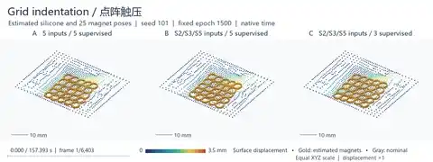
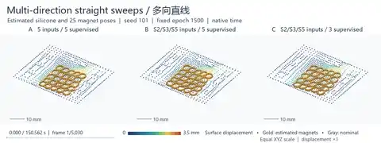
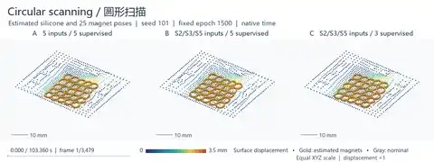
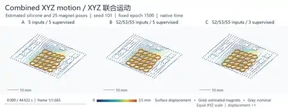
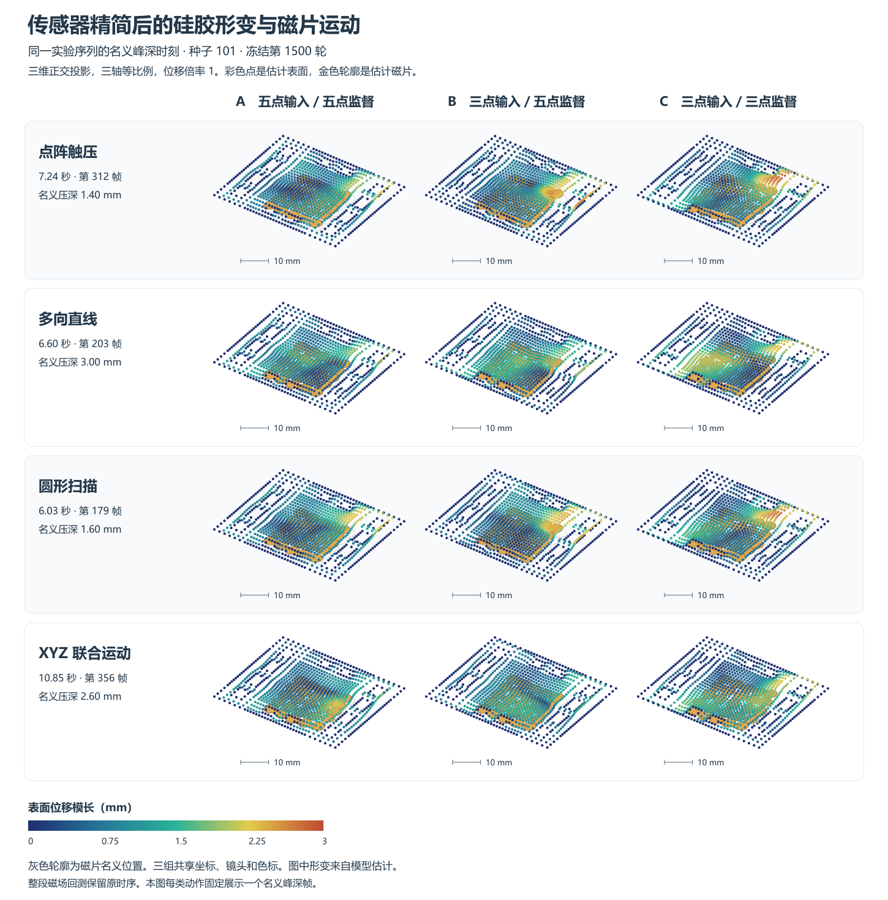

# 三点磁触觉定位论文伴随资料

[中文 PDF](paper/Sparse_Magnetic_Sensors_ZH.pdf) · [中文 Word](paper/Sparse_Magnetic_Sensors_ZH.docx) · [英文 PDF](paper/Sparse_Magnetic_Sensors_EN.pdf) · [英文 Word](paper/Sparse_Magnetic_Sensors_EN.docx)

固定 1500 轮、同一冻结五点 CSML 定位器。A 为五点输入与五点监督，B 为三点输入与五点监督，C 为三点输入与三点监督。A 与 B 量化减少输入的代价，B 与 C 检验遗漏点监督的影响。历史布局筛选用三点实测加两点重建。受控主对照的 A/B/C 均用五点全重建。

原五点资料：[CSML 定位器与冻结权重](https://github.com/googo2025/MagTouch-CSML/tree/02cd40217672b43e0860c9a902ea8b4f77f922ca)、[共享场磁重建](https://github.com/googo2025/magtouch-temporal-state-reconstruction/tree/ca291d4d5324ca4b0fd42658022761cd6cfb9602/methods/shared_field)、[装置与采集平台](https://github.com/googo2025/MagTouch-RA-3d-trajectory-recon/tree/acb12b054abb75be53636fc5f2b4496c61de149c)。

仓库包含两版论文与图、去标识的逐序列评分、布局指标、训练与开发抽样点、统计和重绘代码。运行方法见[仓库首页](README.md)，指标定义见[数据字典](docs/protocol.md)。资料包从保存评分复现论文结果。原始帧和九组训练权重仍在项目归档。

新增两组同序列轨迹图，比较五点实测与种子 101 的 A/B/C。图使用已保存的原始定位输出，选例规则、哈希和逐序列指标见[轨迹回执](data/trajectory_examples_receipt.json)。本次修正“接受且误差 ≤0.5 mm”的统计口径，B 为 85.26%。原始定位均误、P95、覆盖率和接触计数不受影响。

新版正文图 5–8 覆盖点阵触压、多向直线、圆形扫描、XYZ 联合运动。补充图给出同一 XYZ 序列的三维对照。全部沿用原定位资格掩码和冻结输出规则。选例、拒绝计数和原始输出校验见[动作与掩码回执](data/dynamic_trajectory_receipt.json)。

[四类动作回测独立总览](paper/trajectory-gallery.zh.html) 可在本地打开，附修订论文的 PDF 和 Word 入口。

## 硅胶三维形变与磁片运动

论文第 3.5 节比较四条同序列记录的估计硅胶表面和内部 25 片磁片。对固定 1500 轮的种子 101，S2/S3/S5 输入保留五点监督时，四类动作的机械状态估计均更接近五点模型。差异衡量模型间一致性。记录中没有独立实测的硅胶位移场或磁片位姿。

### 四类动作按原速连续回放

完整 MP4 共保留 **16,577 个原生帧**与原始帧间隔。每个画面中的 A、B、C 共用时间戳、视角、物理比例和位移色标。首页预览保留原速并降低帧率，点击预览可打开全帧视频。

| 点阵触压 · 6,403 帧 · 2:37 | 多向直线 · 5,030 帧 · 2:31 |
| --- | --- |
|  |  |
| **圆形扫描 · 3,479 帧 · 1:43** | **XYZ 联合运动 · 1,665 帧 · 0:45** |
|  |  |

[原生帧时序验收](data/native_shape_video_receipt.json) · [早期九帧概览](paper/XYZ_deformation_demo.gif)

[形变诊断与动画时间记录](data/shape_state_diagnostic.json)
