# From Five to Three: Spatial Sampling and Training Supervision for Magnetic Tactile Localization

## Abstract

Reducing the number of online magnetic sensing nodes removes spatial observations and can also weaken constraints on the fields required by a downstream localizer. We separated these effects while retaining an existing five-node localization interface. Six reduced layouts were compared on common development sequences, with an independently retrained central S5 model as a single-node reference. S1/S4/S5 minimized full-field reconstruction error among the reduced layouts, whereas frozen localization screening selected S2/S3/S5. We then compared five inputs with five supervised nodes, three inputs with five supervised nodes, and three inputs with three supervised nodes using three paired seeds, a fixed 1500-epoch budget and the same frozen CSML localizer. With five-node supervision, reducing the input to three nodes increased raw mean localization error by 0.060 mm (95% sequence-resampling interval 0.041–0.080 mm), increased sequence P95 by 0.236 mm and reduced accepted coverage by 1.21 percentage points. Relative to direct five-node measurements, the three-input system retained 0.294 mm mean error and 96.72% coverage. Removing supervision at omitted nodes improved field fit at retained nodes, yet all three runs classified every nominal lifted frame as contact, and only 0.34% of eligible targets were accepted with an error of at most 0.5 mm. Under the seen-indenter development protocol, reducing spatial sampling incurred a measurable localization cost, and field fit at retained nodes did not predict the reliability of the fixed five-node interface.

Keywords: magnetic tactile sensing, spatial subsampling, field reconstruction, contact localization, training supervision

## 1 Introduction

Compliant magnetic tactile systems exploit distributed field changes to estimate force or position. Prior work established methods for designing and calibrating triaxial magnetic tactile sensors [1] and demonstrated contact localization with few magnetic receptors coupled by a continuous deformable medium [2]. ReSkin showed how the sensing electronics can be separated from a replaceable elastomer interface [3]. For a system with an existing five-node localizer, the practical question is how to reduce online measurements while preserving the spatial information the localizer needs. Errors at different locations can contribute similarly to full-field RMSE while affecting contact decisions and coordinate estimates differently.

We address three questions. How do sensor count and placement affect errors over the full field and at omitted nodes? What is the localization cost of using three inputs under unchanged five-node supervision? At fixed three-node input, what happens when supervision at the omitted nodes is removed? We address layout with independent S5 retraining and a matrix of reduced configurations. We address supervision with paired seeds and a common training budget. Freezing the localizer measures compatibility with the existing pipeline while separating reconstruction effects from changes that could arise by retraining the localizer.

## 2 Materials and methods

### 2.1 Sensor layouts and sequence partitions

The reference system has five triaxial nodes: four corners S1–S4 and an offset center S5 at y = +1.406 mm (Fig. 1a). Six reduced layouts used the four corners, either diagonal plus S5, either diagonal alone, or S5 alone. Each layout in the matrix had a recurrent and a framewise model. A separate S5 recurrent model was retrained for 1000 epochs and achieved its lowest development loss at epoch 616. This independent run provides a single-node reference alongside the S5 models in the matrix.

Field reconstruction retained the original complete-sequence partition of 381 training and 101 development sequences. Development recordings covered rounded, conical, hemispherical and small-flat indenters, with 277,348 frames and 3,916,620 valid field components. Localization retained the frozen CSML shared protocol [4]. Its evaluation included 97 eligible sequences, comprising 15 rounded, 52 hemispherical and 30 small-flat sequences, with 132,595 eligible position targets. Contact diagnosis also used 91,863 nominal lifted frames disjoint from those targets. Recorded nominal motion supplied the localization reference.

### 2.2 Reconstruction and controlled training

The reconstruction model combines causal input encoding, spatial queries and a frozen magnetic forward map. Let S denote the online nodes and T the supervised nodes. The encoder receives triaxial field increments and availability flags for S, with native time increments. Omitted input components and their availability flags are set to zero. The recurrent model uses causal history within each reset segment. The framewise model uses only the current frame. A displacement state is queried in space and passed through the fixed forward map H. The resulting predicted increment is H(ûₜ) − H(0). Observed increments are measured fields relative to the acquisition baseline. Training minimizes the normalized squared residual over valid supervised components. The fixed physical map estimates magnet translation and orientation from queries of the shared displacement function at magnet centers and neighboring probes, then superposes finite-cylinder responses at the Hall nodes [5]. The displacement state serves as an intermediate reconstruction variable.

The historical matrix used the checkpoint with lowest development loss within epochs 1–1500, while the independent S5 run used epochs 1–1000. Field metrics were pooled raw full-field RMSE, omitted-node RMSE and absolute-error P95 over valid components. The five-node shared-field model is an engineering reference with a different architecture or training budget from some reduced-input models. For historical localization screening, measured fields at retained nodes were combined with reconstructed fields at omitted nodes and passed to the same frozen localizer. The archived screening selected S2/S3/S5, which was then fixed for the supervision experiment.

The controlled comparison used A, five inputs with five supervised nodes, B, S2/S3/S5 inputs with five supervised nodes, and C, S2/S3/S5 inputs with three supervised nodes. Initialization and sequence order were matched within seed. All nine runs used the same 11,939-parameter recurrent model, 381 training sequences and AdamW. One update per complete sequence yielded 571,500 updates per run. For the set Ω of valid components at supervised nodes in a sequence and magnetic residual rᵢ, the loss was L = Σᵢ∈Ω (rᵢ / 100 µT)² / |Ω|. A prescribed cosine schedule reduced the learning rate from 3 × 10⁻⁴ to 3 × 10⁻⁶ (Fig. 1b). The primary comparison uses fixed epoch-1500 weights. The S1 and S4 residuals did not enter the loss or checkpoint selection for C. Shared displacement parameters and the fixed forward map still constrain those outputs indirectly, while the direct measured residual constraints at those nodes are removed. Changing supervision from B to C altered both the number and spatial distribution of valid supervised components.

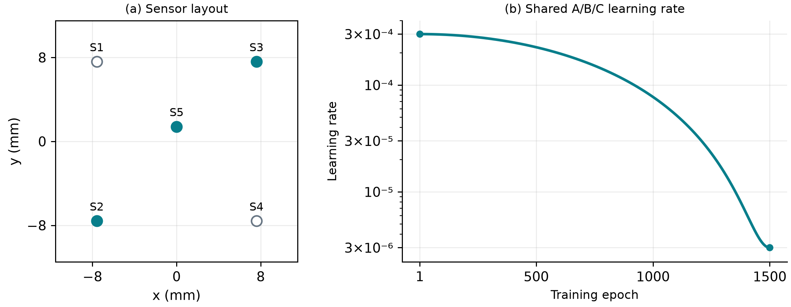

Figure 1. Sensor geometry and training controls. (a) Five-node reference coordinates, with S2/S3/S5 shown as filled markers. (b) Learning-rate schedule shared by the fixed 1500-epoch comparisons.

### 2.3 Frozen localization and estimands

The original localizer consumes fields at five nodes, validity flags and native timing. It outputs coordinates and contact and acceptance states. A, B and C supplied fully reconstructed five-node fields. M denotes direct measured five-node input. All four conditions used identical localization weights, input processing, resets, output thresholds and reference masks, with zero optimization during replay. A−M estimates the cost of reconstructing all five measured inputs. B−A estimates the cost of removing input nodes under full supervision. C−B estimates the effect of changing supervision at fixed three-node input. The historical hybrid route is evaluated separately.

Raw localization error is the Euclidean coordinate error over all eligible targets, including predictions that failed the acceptance rule. We computed mean error, P95 and accepted coverage per complete sequence and weighted sequences equally within domain and domains equally. We also report the weighted fraction of all eligible targets that were accepted with raw error ≤0.5 mm. Missed and false contacts were counted on their respective fixed frame sets, with rates averaged equally across trained seeds. Removing one constant XYZ translation per sequence is a diagnostic.

Intervals are descriptive and post hoc. We computed same-seed differences per sequence and averaged over the three trained seeds. Complete matched sequences were sampled with replacement within each domain. We retained the original domain weights and took the 2.5th and 97.5th percentiles of 10,000 bootstrap replicates, using common resamples across comparisons. These intervals condition on the observed domains, trained seeds and previous layout selection. They do not measure uncertainty over new trained seeds, devices or independent test data.

### 2.4 Provenance of the five-node references

The apparatus repository [6] documents the magnet array, five triaxial Hall nodes and acquisition platform. The five-node CSML repository [4] provides the shared multi-indenter localizer, including inference code, frozen weights and normalization. The published shared weights have the same SHA-256 as the weights used for the frozen replay. Directly feeding measured five-node fields into this localizer defines localization reference M. The shared-field repository [5] describes the five-node reconstruction method and its epoch-529 result, which serves as the magnetic reconstruction reference. The two references address localization performance and field reconstruction quality, respectively.

### 2.5 Matched trajectory displays by action

The trajectory comparison uses seed 101 for A/B/C and direct five-node measurement for M. Acquisition labels identify grid indentation, multi-direction sweeps, circular scanning and combined XYZ motion. Original five-node display eligibility requires an original validation sequence, at least 100 eligible position targets, a nominal peak depth of at least 0.6 mm and nominal XY span of at least 2 mm on one axis. M and B both require at least 90% accepted coverage for a readable paired display. Continuous actions must also meet the XY span condition within a contiguous eligible segment. The combined XYZ segment must additionally have nominal depth variation of at least 0.3 mm. We select the eligible sequence closest to the median measured-input raw mean error within each action.

Black lines or open circles show nominal references within the original shared position mask. Orange lines show raw outputs within that same mask when the original CSML rule accepts them: valid and finite inputs and outputs, contact and support probabilities of at least 0.5, and expected error of at most 0.5 mm. Shallow or off-surface withdrawal frames outside the original position mask are left as gaps. The 0.6 mm criterion refers to sequence peak depth for display eligibility. Eligible loading and withdrawal deviations remain visible, and false contacts on nominal lifted frames are counted in the contact diagnosis. Coordinates and time are shown as saved, without spatial translation, smoothing or temporal alignment.

## 3 Results

### 3.1 Layout changed field reconstruction cost and yielded a different localization choice

The independently trained S5 model had full-field and omitted-node RMSEs of 21.249 and 23.218 µT, respectively. The center-only recurrent model within the layout matrix yielded a similar full-field RMSE of 20.944 µT. Adding two opposite corner nodes to the central measurement reduced full-field error to 8.222 or 8.583 µT, depending on the diagonal. Both values were below the four-corner result of 9.956 µT (Fig. 2 and Supplementary Table S1). Within each layout, the recurrent model yielded lower full-field RMSE than the framewise model. Sensor count alone therefore did not account for reconstruction performance.

S1/S4/S5 achieved the lowest field error among the reduced layouts, whereas the archived frozen-localization screening selected recurrent S2/S3/S5 as the reduced-input candidate. With three measured nodes and two reconstructed nodes, this candidate gave 0.288 mm mean error, 0.712 mm P95 and 96.75% coverage. Relative to measured five-node input, the corresponding changes were +0.054 mm, +0.182 mm and −1.19 percentage points. The hybrid screening established the practical cost of using three online nodes and determined the layout for the controlled comparison. Its results are separate from the fully reconstructed comparison below.

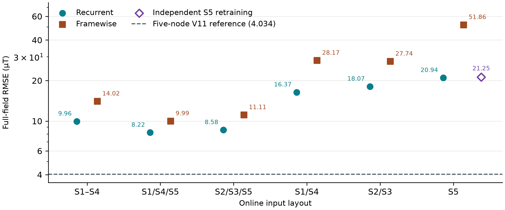

Figure 2. Full-field RMSE on the common magnetic development sequences. Recurrent and framewise versions are shown within each reduced layout, with independent center-only retraining shown separately. The dashed line is the five-node shared-field engineering reference.

### 3.2 With full supervision, input reduction increased tail localization error

The mean error difference between A and measured input was +0.00053 mm (95% interval −0.00033 to +0.00158 mm). Thus full reconstruction from five input nodes yielded a similar mean error to direct measurement in this replay. Supplementary Fig. S1 shows the distribution across sequences. Holding five-node supervision fixed, B increased mean error by 0.060 mm (0.041–0.080), increased sequence P95 by 0.236 mm (0.142–0.346), and reduced coverage by 1.21 percentage points (0.77–1.67). Mean error increased and coverage declined in every seed and every localization domain. The hemispherical domain had the largest coverage loss (2.39 percentage points), while the rounded domain had the largest P95 increase (0.292 mm, Fig. 3).

Relative to direct measurement, B used two fewer online nodes with 25.7% higher mean error and 44.9% higher P95. The miss rate rose from 0.97% to 1.84%, while the false-contact rate point estimate fell from 2.10% to 1.94%. The B−A mean difference remained +0.062 mm after removing a constant translation from each sequence, indicating that the loss included residual time-varying errors.

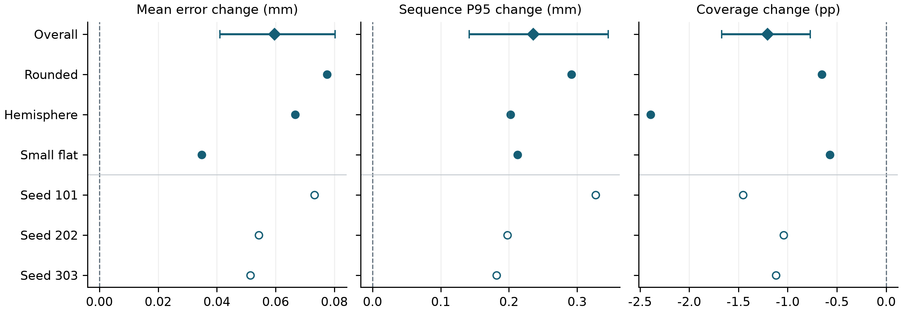

Figure 3. Paired difference between three and five inputs under common five-node supervision (B−A). Diamonds and intervals show the overall effect and conditional resampling interval. Filled circles show domain estimates and open circles show seed estimates.

### 3.3 Retained-node supervision improved local field fit while degrading localization

At the same three inputs, C reduced the retained-node development MSE by 93.3%–94.4% across seeds (Supplementary Fig. S2), while errors increased at omitted nodes. In seed 202, RMSE at S1 and S4 rose from 13.5 and 10.4 µT to 418.2 and 125.8 µT, respectively (Fig. 4a). Under the same localizer, C increased mean localization error over B by 5.229 mm (4.810–5.669). All three C runs classified all 91,863 nominal lifted frames as contact. Accepted coverage reached 100%, yet only 0.34% of eligible targets were accepted within 0.5 mm, compared with 85.26% for B (Fig. 4b). Zero misses and higher accepted coverage thus coincided with loss of contact specificity and spatial accuracy.

Table 1. Frozen localization at the fixed 1500-epoch endpoint. A, B and C are means across the three paired seeds.

| Condition | Mean (mm) | P95 (mm) | Coverage (%) | Accepted ≤0.5 mm (%) | Miss (%) | False contact (%) |
|---|---:|---:|---:|---:|---:|---:|
| Measured five | 0.234 | 0.530 | 97.94 | 90.70 | 0.97 | 2.10 |
| A 5 in / 5 sup. | 0.235 | 0.532 | 97.93 | 90.57 | 0.96 | 2.12 |
| B 3 in / 5 sup. | 0.294 | 0.768 | 96.72 | 85.26 | 1.84 | 1.94 |
| C 3 in / 3 sup. | 5.524 | 8.107 | 100.00 | 0.34 | 0.00 | 100.00 |

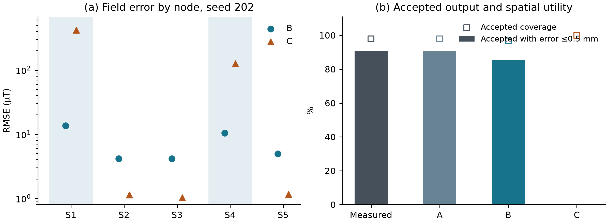

Figure 4. Omitted-node supervision and downstream performance at fixed three-node input. (a) Node RMSE pooled over valid components for seed 202, with omitted input nodes shaded. (b) Accepted coverage and the fraction accepted within 0.5 mm, using the same eligible position targets.

### 3.4 Three inputs with full supervision preserved continuous motion structure

Table 2 separates grid indentation from the three continuous actions. With three inputs and five supervised nodes, B retained the radial directions of straight sweeps, the closed circular path and depth changes during combined XYZ motion (Figs. 6–8). Across the three continuous examples, raw P95 increased by 0.088–0.224 mm, compared with 0.835 mm in the grid example (Fig. 5). These examples illustrate the errors within sequences. The overall evaluation retains all 97 sequences, and the four displays do not establish an action difficulty ranking.

C achieved 100% accepted coverage on all four displayed sequences, yet its circular loop and combined XYZ path were visibly distorted. The trajectory evidence complements the aggregate contact-error diagnosis. Supplementary Fig. S3 presents a high-penalty grid sequence. Supplementary Fig. S4 shows the same sequence as Fig. 8 in an orthographic three-dimensional view.

Table 2. Paired results for the four displayed actions. Mean-error cells give raw / constant-offset diagnostic means in mm. P95 values are raw. M uses five measured nodes, and B uses three inputs with five supervised nodes. All estimates use the same eligible targets within sequence.

| Motion | Targets | M mean (mm) | B mean (mm) | M P95 (mm) | B P95 (mm) | B coverage (%) |
| --- | ---: | ---: | ---: | ---: | ---: | ---: |
| Grid indentation | 2213 | 0.432 / 0.373 | 0.614 / 0.572 | 1.038 | 1.873 | 93.0 |
| Multi-direction sweeps | 4421 | 0.193 / 0.185 | 0.283 / 0.252 | 0.369 | 0.593 | 99.5 |
| Circular scanning | 2591 | 0.195 / 0.191 | 0.251 / 0.249 | 0.425 | 0.513 | 99.7 |
| Combined XYZ motion | 474 | 0.167 / 0.125 | 0.265 / 0.214 | 0.315 | 0.458 | 99.8 |

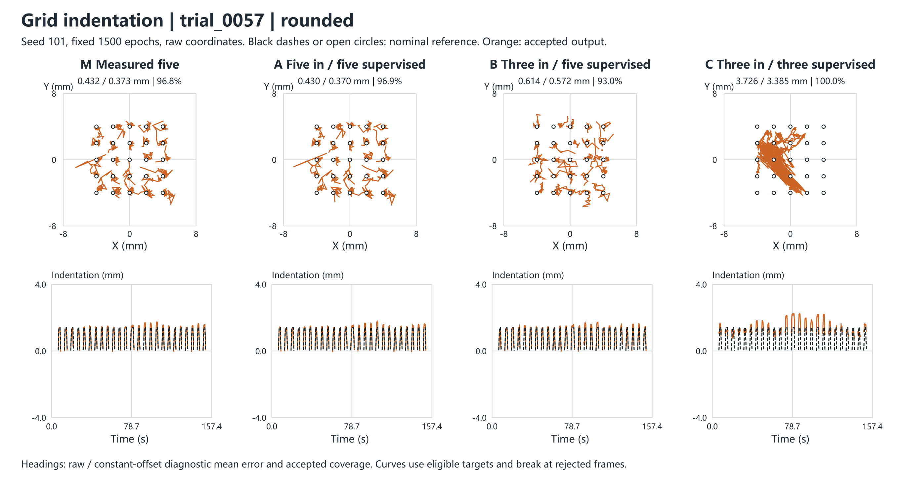

Figure 5. Grid indentation. Open circles mark nominal indentation sites. The top row shows equal-scale XY and the bottom row shows indentation on the native timeline.

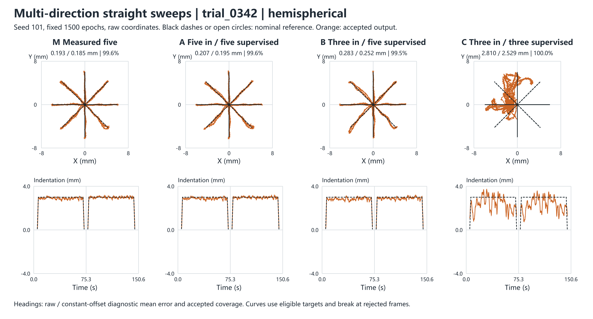

Figure 6. Multi-direction sweeps. The black radial lines mark nominal sweep directions. The top row shows equal-scale XY and the bottom row shows indentation on the native timeline.

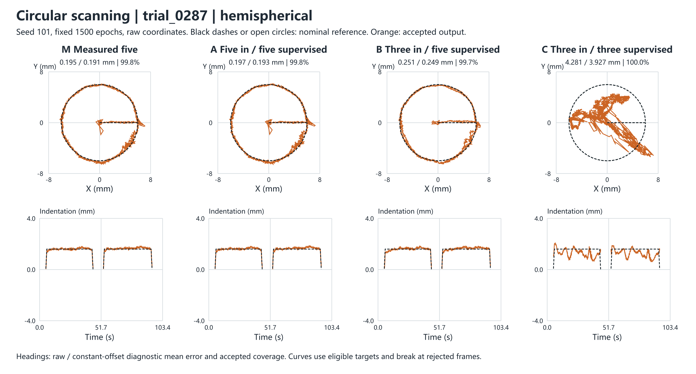

Figure 7. Circular scanning. The XY view shows the closed circular path, paired with the nominal and estimated depth on the original timeline. The top row shows equal-scale XY and the bottom row shows indentation on the native timeline.

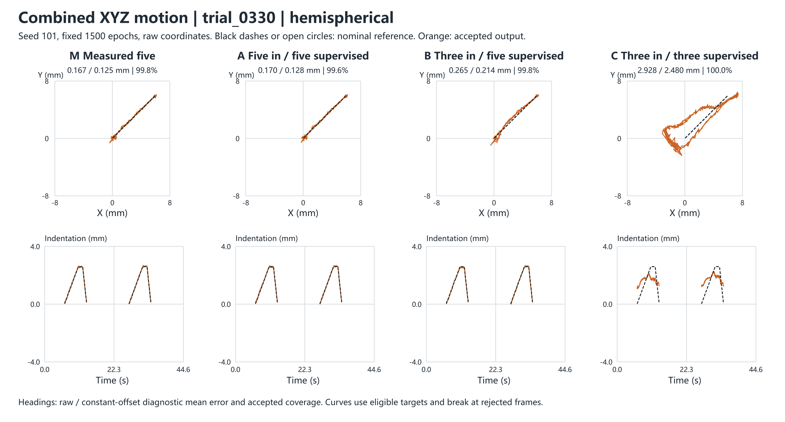

Figure 8. Combined XYZ motion. XY and native-time depth show the position and indentation variation. Supplementary Fig. S4 shows the orthographic three-dimensional view. The top row shows equal-scale XY and the bottom row shows indentation on the native timeline.

## 4 Discussion

The observed effects arise along two paths. With full supervision retained, reducing spatial observations makes reconstruction and localization harder. Here the relative P95 increase exceeded the relative mean increase. Training only at retained nodes also removes direct constraints on reconstructed values at omitted locations. The frozen localizer still consumes those outputs for contact and coordinates, so improved fit at retained nodes does not ensure a reliable interface. The omitted-node errors and false-contact behavior support this interpretation. The study did not measure causal sensitivities to individual node perturbations or separate the effects of supervision count and supervision location.

S2/S3/S5 with five-node supervision is a practical candidate when a 40% reduction in online nodes is valuable and the reported localization losses are acceptable. Applications constrained by tail error, accepted coverage or false contacts on lift should assess those endpoints separately. The field-optimal layout, the localization-selected candidate and the measured five-node reference serve distinct purposes. The historical hybrid screen and controlled reconstruction experiment used different input routes and checkpoints. Their absolute score difference cannot identify the effect of changing routes alone.

The experiments emulate sensor reduction by withholding inputs from five-node hardware recordings. Physical sensor removal, replication across devices, transfer to unseen indenters and retraining a native three-node localizer require separate evidence. Historical layouts were selected and scored on the same development data, with recorded sequence-level reproduction deviations preserved. The localization reference describes nominal motion, and the intervals reflect sequence variation within seen domains. The results therefore inform layout and supervision choices for the specified system without establishing three-node equivalence or a universal minimum sensor count.

## 5 Conclusion

In the original five-node magnetic tactile system, independent center-node retraining and the layout matrix show that both sensor placement and count affect reconstruction. Under a frozen localization interface, S2/S3/S5 with five-node supervision maintains submillimetre mean error after removing two online measurements, with a measurable cost in tail error and accepted coverage. Removing supervision at the omitted nodes can improve the fit at retained nodes while degrading contact and coordinate estimates. Sensor reduction should therefore be evaluated jointly across spatial layout, supervision and the intended localization interface.

## References

[1] Wang H, de Boer G, Kow J, et al. Design Methodology for Magnetic Field-Based Soft Tri-Axis Tactile Sensors. Sensors. 2016, 16(9), 1356. https://doi.org/10.3390/s16091356

[2] Mohammadi A, Xu Y, Tan Y, Choong P, Oetomo D. Magnetic-Based Soft Tactile Sensors with Deformable Continuous Force Transfer Medium for Resolving Contact Locations in Robotic Grasping and Manipulation. Sensors. 2019, 19(22), 4925. https://doi.org/10.3390/s19224925

[3] Bhirangi R, Hellebrekers T, Majidi C, Gupta A. ReSkin: Versatile, Replaceable, Lasting Tactile Skins. Proc. 5th Conference on Robot Learning. PMLR 164, 587–597, 2022. https://proceedings.mlr.press/v164/bhirangi22a.html

[4] googo2025. Five-node CSML: shared localizer, frozen weights and evaluation protocol. [Five-node CSML on GitHub](https://github.com/googo2025/MagTouch-CSML/tree/02cd40217672b43e0860c9a902ea8b4f77f922ca).

[5] googo2025. Five-node shared field: displacement representation, fixed magnetic readout and reconstruction reference. [Five-node shared field on GitHub](https://github.com/googo2025/magtouch-temporal-state-reconstruction/tree/ca291d4d5324ca4b0fd42658022761cd6cfb9602/methods/shared_field).

[6] googo2025. Five-node tactile apparatus and acquisition platform. [Original apparatus on GitHub](https://github.com/googo2025/MagTouch-RA-3d-trajectory-recon/tree/acb12b054abb75be53636fc5f2b4496c61de149c).

## Supplementary material and reproducibility

Supplementary Table S1. Six reduced layouts, independently retrained S5 and the five-node reference. All field errors are raw pooled values in µT.

| Input nodes | Model | Epoch | Full RMSE | Omitted RMSE | Full P95 |
|---|---|---:|---:|---:|---:|
| S1–S5 | V11 frame reference | 529 | 4.034 | — | 7.838 |
| S1/S2/S3/S4 | Recurrent | 1378 | 9.956 | 19.481 | 18.996 |
| S1/S2/S3/S4 | Framewise | 1439 | 14.019 | 28.539 | 24.744 |
| S1/S4/S5 | Recurrent | 1436 | 8.222 | 12.034 | 17.329 |
| S1/S4/S5 | Framewise | 1475 | 9.994 | 14.851 | 20.893 |
| S2/S3/S5 | Recurrent | 1489 | 8.583 | 12.318 | 17.465 |
| S2/S3/S5 | Framewise | 1459 | 11.105 | 16.280 | 21.254 |
| S1/S4 | Recurrent | 1446 | 16.373 | 20.363 | 30.950 |
| S1/S4 | Framewise | 1479 | 28.167 | 35.718 | 49.807 |
| S2/S3 | Recurrent | 710 | 18.071 | 22.309 | 33.863 |
| S2/S3 | Framewise | 1471 | 27.736 | 34.934 | 48.266 |
| S5 | Recurrent | 1087 | 20.944 | 22.981 | 35.576 |
| S5 | Framewise | 1464 | 51.857 | 57.704 | 85.813 |
| S5 | Independent recurrent | 616 | 21.249 | 23.218 | 37.405 |

Supplementary Table S2. Fixed 1500-epoch frozen localization metrics by training seed.

| Condition | Mean (mm) | P95 (mm) | Coverage (%) | Accepted ≤0.5 mm (%) | Miss (%) | False contact (%) |
|---|---:|---:|---:|---:|---:|---:|
| 101 A | 0.234 | 0.534 | 97.90 | 90.72 | 0.96 | 2.15 |
| 101 B | 0.307 | 0.862 | 96.44 | 85.22 | 2.12 | 1.80 |
| 101 C | 4.120 | 6.548 | 100.00 | 0.34 | 0.00 | 100.00 |
| 202 A | 0.234 | 0.532 | 97.94 | 90.63 | 0.97 | 2.12 |
| 202 B | 0.289 | 0.730 | 96.90 | 85.43 | 1.75 | 2.12 |
| 202 C | 6.634 | 9.296 | 100.00 | 0.47 | 0.00 | 100.00 |
| 303 A | 0.236 | 0.531 | 97.95 | 90.36 | 0.95 | 2.10 |
| 303 B | 0.288 | 0.712 | 96.83 | 85.12 | 1.65 | 1.91 |
| 303 C | 5.817 | 8.476 | 100.00 | 0.21 | 0.00 | 100.00 |

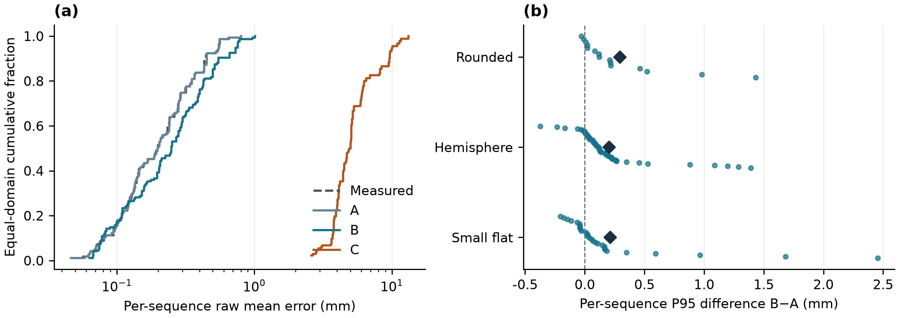

Supplementary Figure S1. Error distributions. (a) Equal-domain cumulative distribution of raw sequence mean error, averaged across seeds within sequence for A/B/C. (b) Per-sequence P95 difference B−A. Diamonds show domain means and vertical jitter is for display.

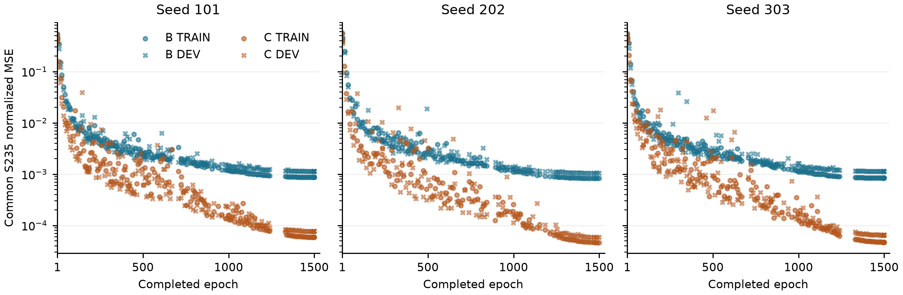

Supplementary Figure S2. Common S235 TRAIN and DEV field error for B/C. Each arm shows 137–168 saved complete-epoch snapshots, including epochs 1 and 1500. Missing epochs are left unsampled.

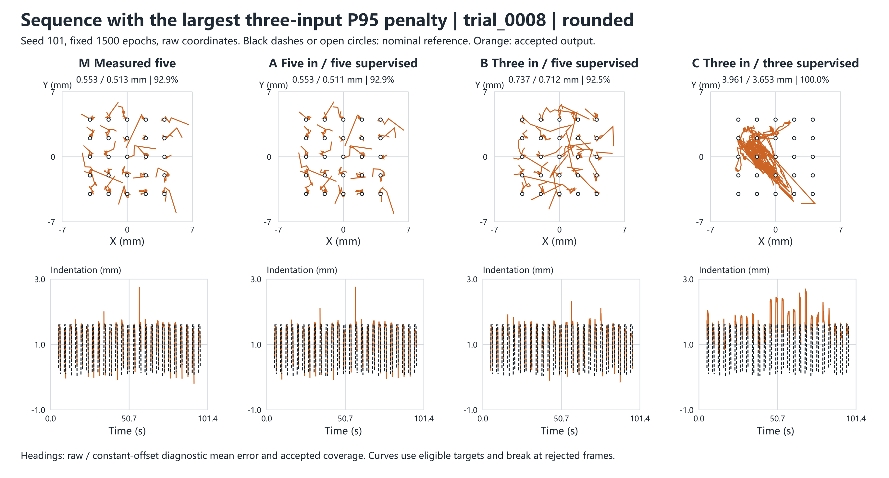

Supplementary Figure S3. Rounded-indenter grid sequence with the largest raw P95 increase in the earlier display pool (B−M, 1.704 mm). It was selected separately from the action-wise median used in Figure 5.

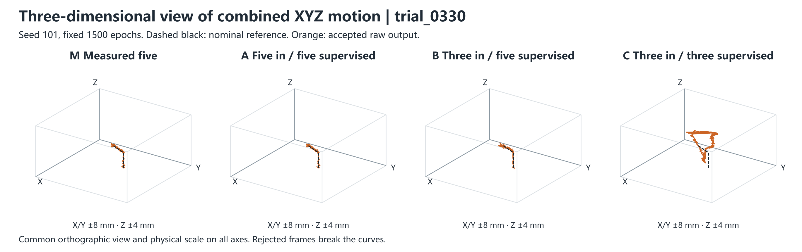

Supplementary Figure S4. Orthographic view of the same sequence as Figure 8, with common viewing angles, physical axes, reference and acceptance masks.

Evidence includes the November 1 layout synthesis and its candidate record, the 13-model reconstruction summary, and per-sequence scoring receipts from the frozen 1500-epoch localization replay. The supplementary statistical analysis uses previously accepted scores and field scalars. The primary comparisons use the fixed 1500-epoch results.
