# 从五点到三点：磁触觉定位的空间采样与监督约束

## 摘要

减少磁触觉传感器的在线测点，既会损失空间观测，也可能削弱对下游定位器所需输入的重建约束。本研究在固定五点定位接口下分离这两种影响。首先，在相同开发序列上比较六种精简布局，并以独立重训的中心 S5 单点模型作为低测点数参照。全场磁场误差最低的精简布局为 S1/S4/S5，而冻结定位筛选选出 S2/S3/S5。随后，以相同的 1500 轮预算、三个配对种子和冻结 CSML 定位器，比较五点输入／五点监督、三点输入／五点监督与三点输入／三点监督。保留五点监督时，改用三点输入使原始定位均误增加 0.060 mm（95% 逐序列重采样区间 0.041–0.080 mm），序列 P95 增加 0.236 mm，接受覆盖率下降 1.21 个百分点。相对五点实测直入，三点方案保留了 0.294 mm 的均误和 96.72% 的覆盖率。取消遗漏点监督后，保留点磁场误差下降，但三个种子均将全部名义抬起帧判为接触，接受且误差不超过 0.5 mm 的目标仅占 0.34%。在已见触头的开发协议下，三点布局有明确的精度代价，而保留点拟合质量不足以评价固定五点定位接口的可靠性。

关键词：磁触觉；稀疏空间采样；磁场重建；接触定位；训练监督

## 1 引言

柔性磁触觉系统利用接触引起的分布式磁场变化估计力或位置。三轴磁敏元件的设计与标定已有系统研究 [1]，连续柔性介质也允许少量磁感受器支持接触定位 [2]。ReSkin 则展示了磁敏电子元件与可更换弹性表面分离的设计 [3]。对于已有五点定位器的系统，实际精简问题是如何减少在线测量，同时保留定位器所依赖的空间信息。不同位置的磁场误差即使对全场 RMSE 贡献相近，对接触判断和坐标预测的影响也可能不同。

本文分别检验三个问题。第一，改变空间布局和测点数如何改变全场及遗漏点误差？第二，固定五点监督时，三点输入给原定位器带来多大代价？第三，在线输入已经固定为三点时，取消遗漏点监督会怎样影响其下游可靠性？为此，布局筛选使用独立 S5 重训与多布局矩阵，监督对照使用固定训练预算和配对种子。冻结定位器用于衡量精简输入对既有系统的兼容性，同时把重建器的影响与定位器重新训练区分开。

## 2 材料与方法

### 2.1 采样布局与数据划分

五个三轴测点包括四角 S1–S4 和偏置中心 S5，后者位于 y = +1.406 mm（图 1a）。比较四角、两条对角线各自加 S5、两条对角线各自单独使用和 S5 单点，共六种精简布局。矩阵中每种布局均有记忆和逐帧模型。独立 S5 记忆模型另行重训 1000 轮，开发集最低损失在第 616 轮。它作为单点能力的独立参照，矩阵中的单点模型仍用于同矩阵比较。

磁场任务沿用完整实验序列划分，包括 381 条训练和 101 条开发序列。磁场开发数据含圆弧、锥形、半球和小平头触头，共 277,348 帧和 3,916,620 个有效磁场分量。定位评价沿用冻结 CSML 的共享协议 [4]，使用其中符合该协议的 97 条序列，包括 15 条圆弧、52 条半球和 30 条小平头序列，共 132,595 个合格定位目标。接触诊断另使用 91,863 个与定位目标互斥的名义抬起帧。定位参照为原记录的名义运动坐标。

### 2.2 磁场重建与受控训练

重建器由因果输入编码、空间查询和冻结磁场映射组成。令 S 表示在线节点集合，T 表示受监督节点集合。编码器接收 S 内的三轴增量、可用标记及原生采样间隔。S 外的三轴输入和可用标记置零。记忆版本利用同一重置段内的因果历史，逐帧版本仅使用当前帧。模型在各空间查询点预测位移状态，冻结物理映射 H 将该状态转换为磁场，预测增量为 H(ûₜ) − H(0)。观测增量为实测场减采集基线。训练以有效目标分量的归一化平方残差为损失；原物理映射根据同一位移函数在磁体中心及邻域的查询推定磁体平移和取向，再将有限圆柱磁体在各霍尔测点的响应叠加 [5]。位移状态作为重建中间量。

历史布局矩阵使用第 1–1500 轮的最低开发损失检查点，独立 S5 的窗口为第 1–1000 轮。磁场结果报告有效标量合并后的原始全场 RMSE、遗漏点 RMSE 和绝对误差 P95。完整五点共享场模型为工程参照，其架构和训练预算与部分精简组有差别。历史定位筛选保留在线节点的实测值，只替换遗漏节点，再送入同一冻结定位器。由保存的筛选结果选出 S2/S3/S5，随后固定该布局检验监督范围。

受控实验设 A（五点输入、五点监督）、B（S2/S3/S5 输入、五点监督）和 C（S2/S3/S5 输入、三点监督）。每个种子内配对初始化与序列顺序。九组采用同一 11,939 参数记忆模型、381 条训练序列和 AdamW，每条完整序列一次更新，每组 571,500 次。设 Ω 为当前序列中 T 内的有效分量集合，rᵢ 为相应磁场残差，则序列损失为 L = Σᵢ∈Ω (rᵢ / 100 µT)² / |Ω|。学习率从 3 × 10⁻⁴ 按预定余弦下降至 3 × 10⁻⁶（图 1b），主结果取固定 1500 轮终态。C 的 S1、S4 残差不进入损失或检查点选择。共享位移参数和固定磁场映射仍间接约束 S1、S4 的输出，但这些位置缺少实测残差的直接约束。B 与 C 的监督变化同时涉及有效分量数和空间位置。

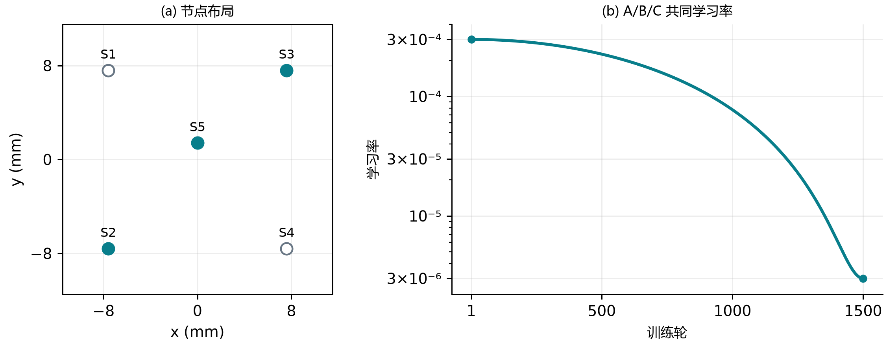

图 1 实验布局与训练控制。（a）原五点坐标，实心标记为 S2/S3/S5。（b）固定 1500 轮对照共用的学习率。

### 2.3 冻结定位接口与统计量

原定位器使用五点磁场、有效标记和原生时序，输出坐标及接触与接受状态。受控实验的 A、B、C 均向定位器提供五点全重建场。五点实测直入记为 M。四种条件复用相同定位权重、输入处理、状态重置、输出阈值及参考掩码，回测零优化。A−M 估计五点全重建本身的代价，B−A 估计完整监督下的输入删减代价，C−B 估计固定三点输入下改变监督的影响。历史筛选的混合接口另行解释。

定位误差为原始三维欧氏距离，在所有合格定位目标上计分，包含未通过接受规则的坐标预测。每条序列分别计算均误、P95 和接受覆盖率，再按域内序列等权、域间等权汇总。另报告接受且原始误差 ≤0.5 mm 的目标占全体合格目标的加权比例。漏检与误检以各自固定帧集计数，三个训练种子的比率等权。整序列减去一个常量 XYZ 偏移仅用于诊断。

统计区间为事后描述性分析。对每条序列先计算同种子条件差，再对三种子取均值。在三个触头域内分别有放回抽取完整配对序列，按原域权重汇总，共 10,000 次，取 2.5% 和 97.5% 分位数。所有比较复用同一批重采样索引。区间以当前触头域、训练种子与已有布局选择为条件，不涵盖新种子、硬件样机或独立测试集的不确定性。

### 2.4 原五点系统与基准来源

原五点系统的磁体阵列、五个三轴霍尔测点和采集平台见装置仓库 [6]。原五点 CSML 仓库 [4] 提供共享多触头定位器的推理代码、冻结权重和归一化参数。公开的共享权重与本研究冻结回测使用的权重 SHA-256 一致。五点实测磁场直入该定位器构成定位基准 M。共享场仓库 [5] 提供五点磁场重建方法和第 529 轮共享场结果，用作磁场重建参照。两个基准分别回答定位表现与磁场重建质量。

### 2.5 动作轨迹的配对展示

展示使用种子 101 的 A/B/C 和五点实测 M。动作标签来自原采集记录，按点阵触压、多向直线、圆形扫描和 XYZ 联合运动分组。沿用原五点论文的展示资格：已在原验证集、至少 100 个合格定位目标、名义峰深至少 0.6 mm、XY 至少一轴跨度 2 mm。为保证同序列对照可读，M 和 B 的接受覆盖率均须达到 90%。连续动作还须在同一合格连续段内满足 XY 跨度，XYZ 组在该段内还须有至少 0.3 mm 的名义压深变化。每类选取五点实测原始均误最接近该类合格样本中位数的一条序列。

黑线或空心点使用原共享定位资格掩码内的名义参考。橙线只使用同一掩码内、且通过原 CSML 接受规则的原始输出：输入与输出有效且有限，接触概率和支撑概率均不低于 0.5，误差代理不高于 0.5 mm。原协议判为无定位资格的浅触与离面回撤处断线。0.6 mm 是序列选例所用的名义峰深门槛。仍在评分掩码内的加载或回撤偏差如实显示。误差统计用原资格掩码的全部目标，抬起误检仍在接触诊断中计数。图中的时间、坐标和断线均来自保存的回测，无平移、平滑或时间对齐。

## 3 结果

### 3.1 布局改变了磁场重建代价，定位筛选给出不同排序

独立 S5 的全场与遗漏点 RMSE 分别为 21.249 和 23.218 µT。矩阵内 S5 记忆版本的全场误差为 20.944 µT，与独立训练给出的误差量级接近。加入两个对角测点后，两个三点记忆布局的全场误差降至 8.222 和 8.583 µT，均低于仅保留四角的 9.956 µT（图 2、补充表 S1）。在每个精简布局内，记忆版本的全场误差都低于逐帧版本。这些比较说明，测点数相同或增加时，仍需考虑保留的具体空间位置。

磁场重建最优的 S1/S4/S5 没有成为后续定位对照的布局。已归档的冻结定位筛选选出 S2/S3/S5 记忆模型作为少测点候选。用三点实测与两点重建时，均误、P95、覆盖率分别为 0.288 mm、0.712 mm、96.75%，相对五点实测均误增加 0.054 mm，P95 增加 0.182 mm，覆盖率下降 1.19 个百分点。该结果给出了采用三个在线节点的应用代价，并确定受控实验的布局。它使用混合接口，与下节的全重建结果分列。

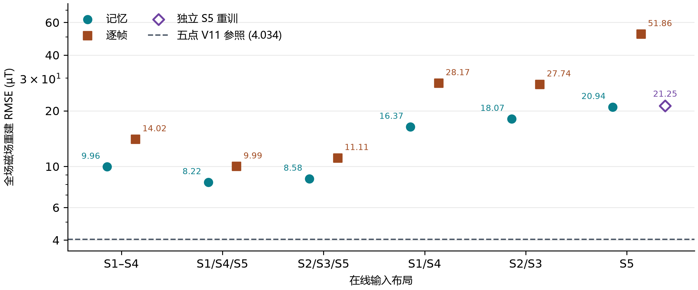

图 2 共同磁场开发序列上的全场 RMSE。每种精简布局比较记忆与逐帧版本，独立中心 S5 重训另标。虚线为五点共享场工程参照。

### 3.2 保留五点监督时，删减输入主要增加定位尾部误差

A 与五点实测的均误差仅 +0.00053 mm（95% 区间 −0.00033 至 +0.00158 mm）。因此，五点全重建在本次回测中的均误与实测直入接近。各组逐序列误差分布见补充图 S1。固定五点监督后，B 相对 A 的均误增加 0.060 mm（0.041–0.080），P95 增加 0.236 mm（0.142–0.346），覆盖率降低 1.21 个百分点（0.77–1.67）。三个种子与三个触头域均出现均误上升和覆盖率下降。半球的覆盖率降幅最大（2.39 个百分点），圆弧的 P95 增幅最大（0.292 mm，图 3）。整体均值掩盖了这些不同的损失方式。

相对五点实测，B 以少两个在线节点换取约 25.7% 的均误增幅和 44.9% 的 P95 增幅。漏检率由 0.97% 升至 1.84%，误检率点估计由 2.10% 降至 1.94%。剔除每条序列的常量偏移后，B−A 的均误差仍为 +0.062 mm，说明退化包含随时序变化的残余误差。

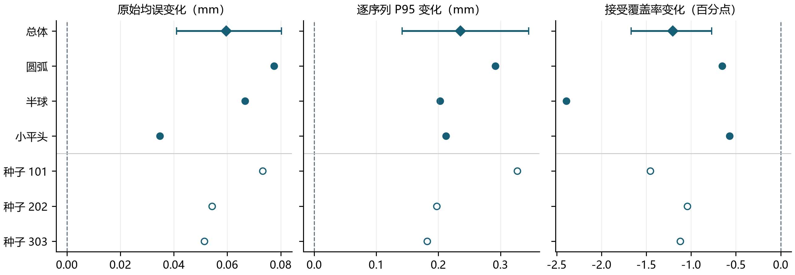

图 3 五点监督下，三点输入相对五点输入的配对差（B−A）。菱形及区间为总体估计与条件重采样区间。实心圆为各触头域估计，空心圆为各训练种子估计。

### 3.3 只监督保留点，磁场局部误差改善而定位失效

输入相同的 B 与 C 对照中，C 的保留点开发 MSE 在三个种子中降低 93.3%–94.4%（补充图 S2），但遗漏点误差放大。以种子 202 为例，S1 和 S4 的 RMSE 分别从 13.5 和 10.4 µT 升至 418.2 和 125.8 µT（图 4a）。同一定位器下，C 相对 B 的均误增加 5.229 mm（4.810–5.669）。C 在三次训练中都把全部 91,863 个名义抬起帧判为接触。其接受覆盖率达到 100%，而被接受且误差 ≤0.5 mm 的目标比例只有 0.34%，低于 B 的 85.26%（图 4b）。因此，本实验中的接触漏检为零和覆盖率升高，同时伴随接触特异性和坐标可靠性的退化。

表 1 固定 1500 轮的冻结定位结果。A、B、C 为三个配对种子的均值。

| 条件 | 均误 (mm) | P95 (mm) | 覆盖率 (%) | 接受且 ≤0.5 mm (%) | 漏检 (%) | 误检 (%) |
|---|---:|---:|---:|---:|---:|---:|
| 五点实测 | 0.234 | 0.530 | 97.94 | 90.70 | 0.97 | 2.10 |
| A 五点／五点 | 0.235 | 0.532 | 97.93 | 90.57 | 0.96 | 2.12 |
| B 三点／五点 | 0.294 | 0.768 | 96.72 | 85.26 | 1.84 | 1.94 |
| C 三点／三点 | 5.524 | 8.107 | 100.00 | 0.34 | 0.00 | 100.00 |

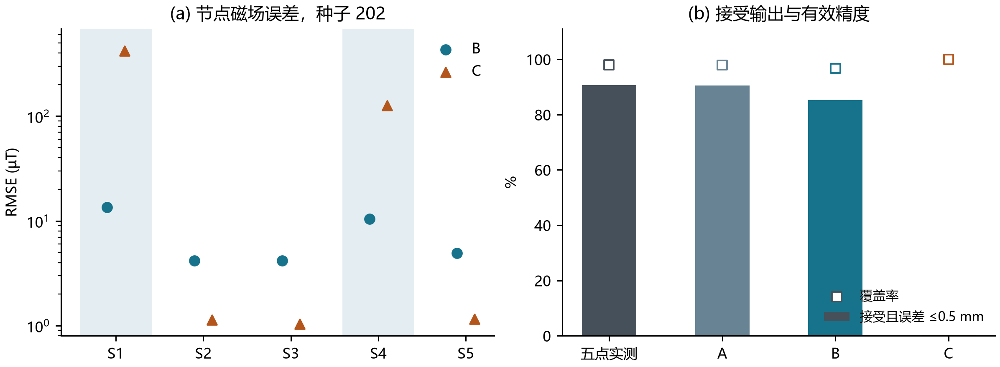

图 4 固定三点输入时，遗漏点监督与下游表现。（a）种子 202 的有效分量池化节点 RMSE，灰底为省略的在线节点。（b）覆盖率与接受且误差 ≤0.5 mm 的目标比例，共用同一合格目标分母。

### 3.4 保留五点监督时，三点输入保留了连续运动结构

表 2 将点阵触压与三类连续运动分列。三点输入、五点监督的 B 保留了多向直线的放射结构、圆形路径和 XYZ 联合运动的压深变化（图 6–8）。三个连续运动展示序列的 P95 增量为 0.088–0.224 mm，点阵示例的增量为 0.835 mm（图 5）。这四条序列用于定位误差的可视化，样本不支持对四类动作作总体难度排序。

C 在四条序列上均达到 100% 接受覆盖率，仍出现圆形闭环变形及 XYZ 路径偏移。因而，图中几何与时间误差和总体误检结论一致。补充图 S3 单列高退化点阵序列，补充图 S4 给出与图 8 同一序列的三维正交视图。

表 2 四类配对展示序列的原始与常量消偏误差。均误栏依次为原始／整序列常量消偏均误。P95 为原始值。M 为五点实测，B 为三点输入／五点监督。各栏使用相同合格目标。

| 动作 | 定位目标 | M 均误（mm） | B 均误（mm） | M P95（mm） | B P95（mm） | B 覆盖率（%） |
| --- | ---: | ---: | ---: | ---: | ---: | ---: |
| 点阵触压 | 2213 | 0.432 / 0.373 | 0.614 / 0.572 | 1.038 | 1.873 | 93.0 |
| 多向直线 | 4421 | 0.193 / 0.185 | 0.283 / 0.252 | 0.369 | 0.593 | 99.5 |
| 圆形扫描 | 2591 | 0.195 / 0.191 | 0.251 / 0.249 | 0.425 | 0.513 | 99.7 |
| XYZ 联合运动 | 474 | 0.167 / 0.125 | 0.265 / 0.214 | 0.315 | 0.458 | 99.8 |

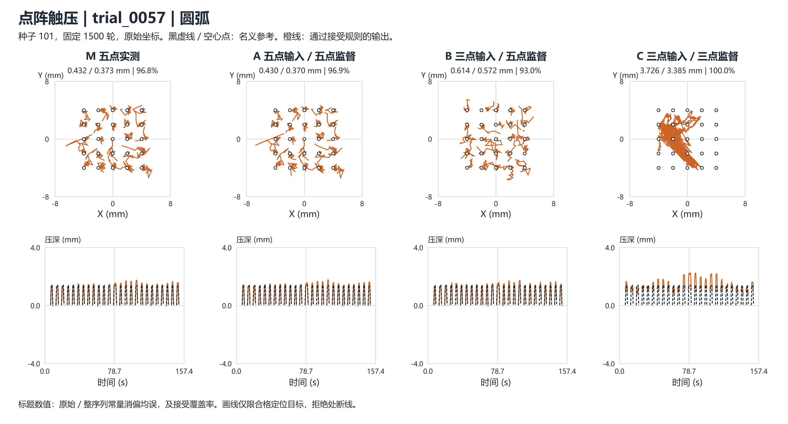

图 5 点阵触压。空心点标明名义按压位置。上排为等比例 XY，下排为原生时间压深。

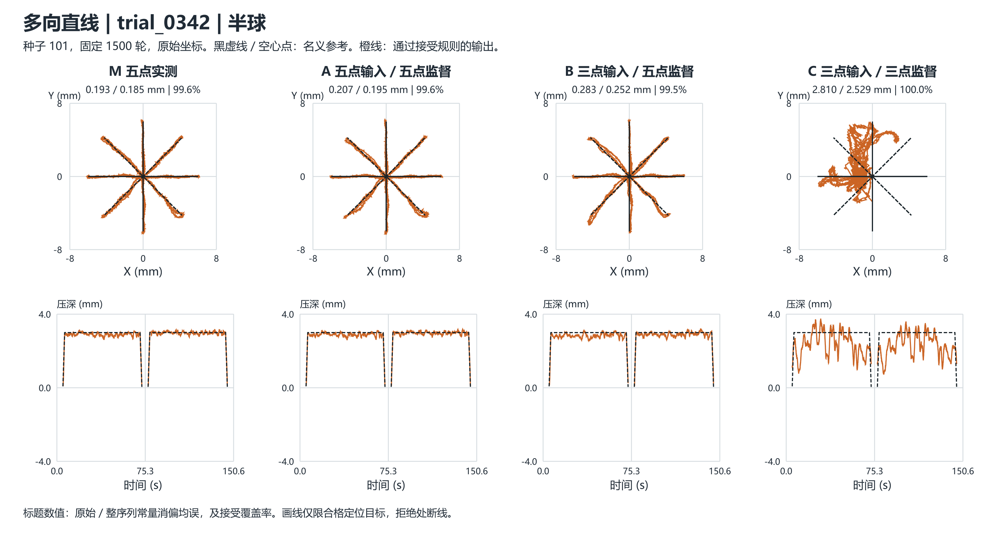

图 6 多向直线。黑色放射线给出名义方向。上排为等比例 XY，下排为原生时间压深。

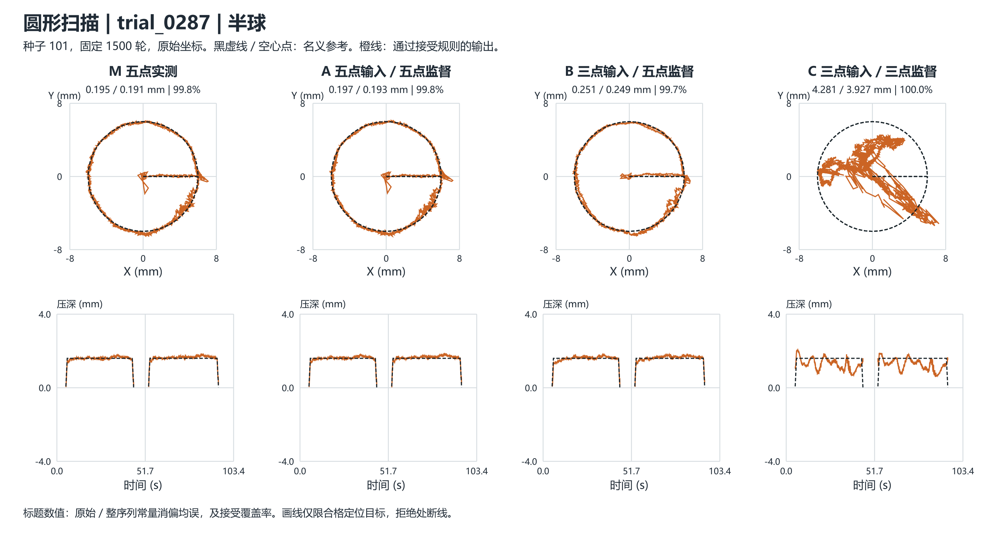

图 7 圆形扫描。XY 投影呈现闭合圆周，压深曲线对照圆周运动中的名义压深。上排为等比例 XY，下排为原生时间压深。

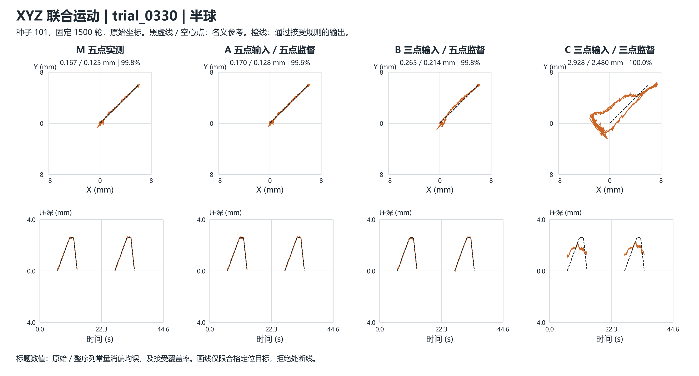

图 8 XYZ 联合运动。XY 与原生时间压深联合显示位置和压深变化，三维视图见补充图 S4。上排为等比例 XY，下排为原生时间压深。

### 3.5 保留五点监督可减小估计硅胶形变与磁片状态的变化

为评估传感器精简对机械状态估计的影响，采用种子 101 的第 1500 轮冻结循环共享位移场，复用图 5–8 所示的四条开发序列。模型按原生磁场时序及原重置标记编码。每条序列取九个同步帧，包括记录的首尾、按合格帧索引均匀抽取的六帧及名义峰深帧。每帧查询 988 个注册表面节点和用于导出 25 片磁片位姿的 175 个物理探针。以五点输入模型 A 的估计为参照，计算跨采样点和帧的表面位移与磁片中心欧氏 RMS 差异，以及跨磁片和帧的平均相对转角。由同一状态重算的磁场与保存预测的最大分量绝对差不超过 0.000475 µT。

在四条序列中，B 的表面位移、磁片中心及磁片方向均比 C 更接近 A（表 3）。B 的表面位移 RMS 差异为 0.491–0.562 mm，C 为 0.682–0.737 mm。图 9 比较同一名义峰深时刻的估计表面和磁片位姿。XYZ 联合运动演示按压缩后的时间间隔呈现九个原生状态。五点模型的估计仅作为对照。当前记录缺少独立测得的硅胶位移场和磁片位姿，这组数值衡量单种子四条序列中的模型间一致性。

表 3 同步帧上相对五点输入估计状态 A 的差异。各指标分别列出 B 和 C 相对 A 的数值。

| 动作 | B 表面 RMS (mm) | C 表面 RMS (mm) | B 中心 RMS (mm) | C 中心 RMS (mm) | B 平均转角 (°) | C 平均转角 (°) |
| --- | ---: | ---: | ---: | ---: | ---: | ---: |
| 点阵触压 | 0.491 | 0.706 | 0.467 | 0.892 | 3.90 | 5.45 |
| 多向直线 | 0.513 | 0.698 | 0.476 | 0.856 | 3.80 | 5.17 |
| 圆形扫描 | 0.519 | 0.737 | 0.470 | 0.884 | 3.83 | 5.58 |
| XYZ 联合运动 | 0.562 | 0.682 | 0.509 | 0.858 | 4.00 | 5.49 |

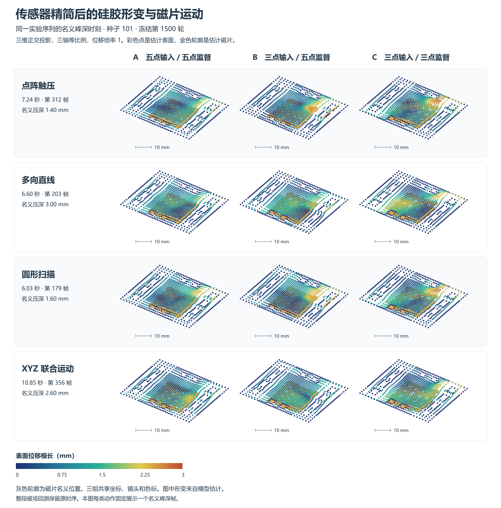

图 9 四类动作在相同名义峰深帧的估计硅胶表面位移与内部磁片运动。各组使用同一正交视角、物理轴比例和色标。彩色点为估计表面，金色轮廓为估计磁片，灰色轮廓为磁片名义位置。位移倍率为 1。

## 4 讨论

同序列形变诊断将定位对照延伸到产生磁响应的状态。在共享位移场中，缩小监督范围同时改变了估计表面位移和磁片运动。要判断这些变化在多大程度上对应实物精度，仍需独立测量位移与位姿。

稀疏输入的作用通过两条路径体现。即使完整监督保持不变，删减空间观测也会加大重建和定位的不确定性；本实验中，P95 的相对增幅大于均误。另一方面，训练时只拟合保留位置，会减弱对未测位置输出的直接约束。冻结定位器仍使用这些位置来估计接触和坐标，因此保留点误差下降并不能保证接口有效。遗漏点误差及接触误检的共同变化支持这种解释；本研究未测量定位器对单节点扰动的因果敏感度，也未将监督数量与监督位置的影响分开。

工程上，S2/S3/S5 配五点监督适合将在线通道减少 40% 且可容忍所报告定位损失的场景。若约束的是尾部误差、接受覆盖率或抬起误触，则应分别考察这些指标。磁场最优布局、定位候选布局以及五点实测基准各回答不同问题。混合接口的历史筛选与全重建受控对照使用不同的输入路由和检查点，二者的绝对差异不能估计路由本身的收益。

本研究用屏蔽在线输入模拟精简，原记录来自五点硬件。实际拆除传感器后的装配变化、跨器件复现、未见触头以及针对三点输入重新训练定位器的表现仍需独立评价。历史布局比较使用同一开发集选模及评分，并保留原逐序列数值复算偏差。定位使用名义运动参考，区间描述已见触头的序列变异。因此，这些结果支持指定系统中的布局和监督决策，尚不足以确立三点与五点等效或三点为普适最小配置。

## 5 结论

在原五点磁触觉系统上，中心单点重训与多布局对照表明空间布局和测点数共同决定重建误差。对冻结定位接口，S2/S3/S5 保留五点监督时可以在减少两个在线节点后维持亚毫米均误，但会付出可测的尾部误差和覆盖率代价。若同时取消遗漏点监督，保留点磁场拟合改善也可能伴随定位失效。传感器精简应将布局、训练监督和定位器输入接口一起设计，并以冻结定位的误差与接触判别共同验收。

## 参考文献

[1] Wang H, de Boer G, Kow J, et al. Design Methodology for Magnetic Field-Based Soft Tri-Axis Tactile Sensors. Sensors. 2016, 16(9), 1356. https://doi.org/10.3390/s16091356

[2] Mohammadi A, Xu Y, Tan Y, Choong P, Oetomo D. Magnetic-Based Soft Tactile Sensors with Deformable Continuous Force Transfer Medium for Resolving Contact Locations in Robotic Grasping and Manipulation. Sensors. 2019, 19(22), 4925. https://doi.org/10.3390/s19224925

[3] Bhirangi R, Hellebrekers T, Majidi C, Gupta A. ReSkin: Versatile, Replaceable, Lasting Tactile Skins. Proc. 5th Conference on Robot Learning. PMLR 164, 587–597, 2022. https://proceedings.mlr.press/v164/bhirangi22a.html

[4] googo2025. 原五点 CSML：共享定位器、冻结权重与评价协议。 [GitHub 五点定位器](https://github.com/googo2025/MagTouch-CSML/tree/02cd40217672b43e0860c9a902ea8b4f77f922ca).

[5] googo2025. 原五点共享场：位移表示、固定磁场映射与重建参照。 [GitHub 五点共享场](https://github.com/googo2025/magtouch-temporal-state-reconstruction/tree/ca291d4d5324ca4b0fd42658022761cd6cfb9602/methods/shared_field).

[6] googo2025. 五点磁触觉装置与采集平台。 [GitHub 原装置](https://github.com/googo2025/MagTouch-RA-3d-trajectory-recon/tree/acb12b054abb75be53636fc5f2b4496c61de149c).

## 补充材料与复现

补充表 S1 六种布局、独立 S5 和五点工程参照。均为原始池化磁场误差，单位 µT。

| 输入节点 | 模型 | 选模轮 | 全场 RMSE | 遗漏点 RMSE | 全场 P95 |
|---|---|---:|---:|---:|---:|
| S1–S5 | V11 逐帧参照 | 529 | 4.034 | — | 7.838 |
| S1/S2/S3/S4 | 记忆 | 1378 | 9.956 | 19.481 | 18.996 |
| S1/S2/S3/S4 | 逐帧 | 1439 | 14.019 | 28.539 | 24.744 |
| S1/S4/S5 | 记忆 | 1436 | 8.222 | 12.034 | 17.329 |
| S1/S4/S5 | 逐帧 | 1475 | 9.994 | 14.851 | 20.893 |
| S2/S3/S5 | 记忆 | 1489 | 8.583 | 12.318 | 17.465 |
| S2/S3/S5 | 逐帧 | 1459 | 11.105 | 16.280 | 21.254 |
| S1/S4 | 记忆 | 1446 | 16.373 | 20.363 | 30.950 |
| S1/S4 | 逐帧 | 1479 | 28.167 | 35.718 | 49.807 |
| S2/S3 | 记忆 | 710 | 18.071 | 22.309 | 33.863 |
| S2/S3 | 逐帧 | 1471 | 27.736 | 34.934 | 48.266 |
| S5 | 记忆 | 1087 | 20.944 | 22.981 | 35.576 |
| S5 | 逐帧 | 1464 | 51.857 | 57.704 | 85.813 |
| S5 | 独立记忆 | 616 | 21.249 | 23.218 | 37.405 |

补充表 S2 各种子固定 1500 轮的冻结定位指标。

| 条件 | 均误 (mm) | P95 (mm) | 覆盖率 (%) | 接受且 ≤0.5 mm (%) | 漏检 (%) | 误检 (%) |
|---|---:|---:|---:|---:|---:|---:|
| 101 A | 0.234 | 0.534 | 97.90 | 90.72 | 0.96 | 2.15 |
| 101 B | 0.307 | 0.862 | 96.44 | 85.22 | 2.12 | 1.80 |
| 101 C | 4.120 | 6.548 | 100.00 | 0.34 | 0.00 | 100.00 |
| 202 A | 0.234 | 0.532 | 97.94 | 90.63 | 0.97 | 2.12 |
| 202 B | 0.289 | 0.730 | 96.90 | 85.43 | 1.75 | 2.12 |
| 202 C | 6.634 | 9.296 | 100.00 | 0.47 | 0.00 | 100.00 |
| 303 A | 0.236 | 0.531 | 97.95 | 90.36 | 0.95 | 2.10 |
| 303 B | 0.288 | 0.712 | 96.83 | 85.12 | 1.65 | 1.91 |
| 303 C | 5.817 | 8.476 | 100.00 | 0.21 | 0.00 | 100.00 |

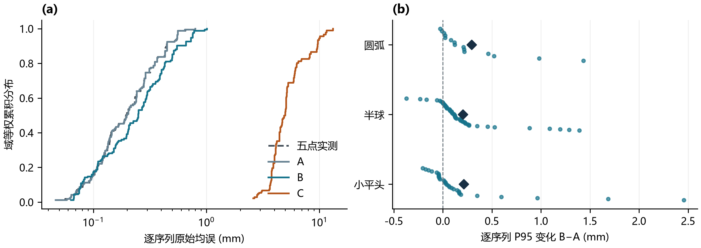

补充图 S1 定位误差分布。（a）先对每条序列取三种子均值，再绘制域等权原始均误累积分布。五点实测无种子平均。（b）B−A 的逐序列 P95 差，菱形为各域均值，纵向错开仅供显示。

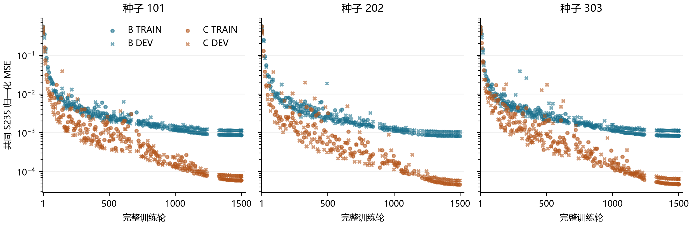

补充图 S2 B/C 的共同 S235 TRAIN 与 DEV 磁场误差。每组绘制 137–168 个已保存的完整轮快照，均包含第 1 和第 1500 轮。未采样轮未插值。

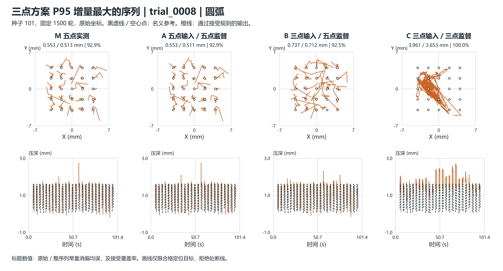

补充图 S3 早期展示中 B 相对 M 的原始 P95 增量最大的合格序列，为圆弧触头点阵触压（增量 1.704 mm）。其选例依据独立于图 5 的动作内中位选择。

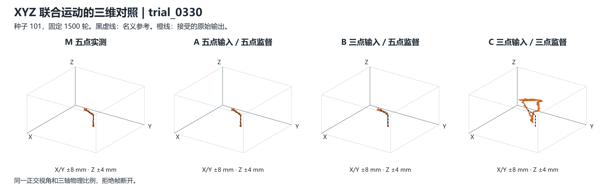

补充图 S4 图 8 同一实验序列的三维正交视图。所有面板沿用相同视角、物理尺度、参考和接受掩码。

证据包括 11 月 1 日布局研究整理及其候选回执、13 组磁场汇总、1500 轮冻结回测的逐序列评分回执。本文补充统计仅复用已验收的评分与磁场标量，主对照不使用延训结果。
